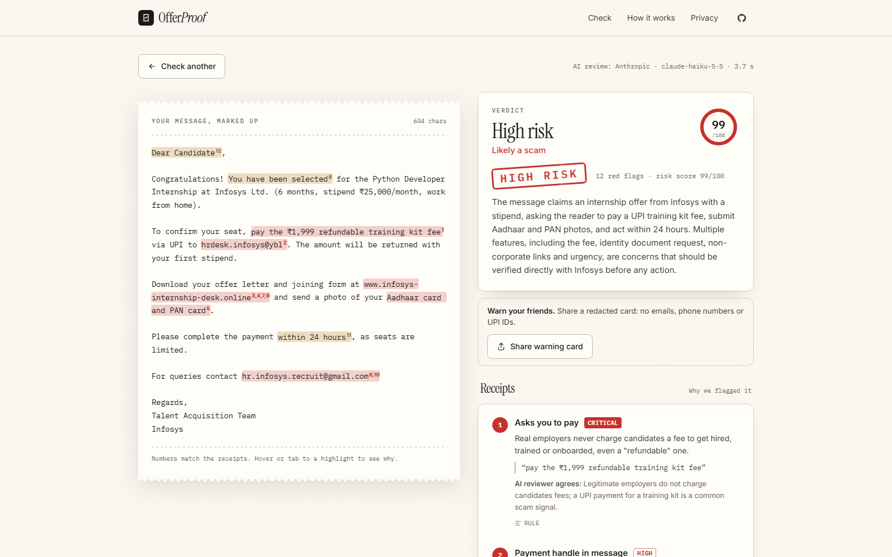

# OfferProof

**Receipts, not vibes: scam-check any job or internship offer in about 10 seconds.**

Live: **https://offerproof-two.vercel.app** · No sign-up · MIT licensed · Built for LaunchPad Hacks 2026

Paste a recruiter message, email or offer letter, or drop a screenshot. OfferProof highlights every red flag in the text, backs each one with a *receipt* (a deterministic rule, a live domain lookup, or an AI flag whose quote was verified to exist in your message), gives a 0–100 risk verdict, and tells you what to do next. It never says "safe".



## The problem

Fake job and internship offers target the people least equipped to spot them: students and first-time job-seekers.

- FTC data shows job and employment-agency scam reports **tripled from 2020 to 2024**, and business and job-opportunity losses reached **$750.6M in 2024** ([FTC](https://www.ftc.gov/news-events/news/press-releases/2025/03/new-ftc-data-show-big-jump-reported-losses-fraud-125-billion-2024)).
- In India, fake internships charging "registration" or "training" fees are common enough that IIT Roorkee and PIB Fact Check issued warnings in 2026 ([Careers360](https://news.careers360.com/iit-roorkee-fake-internship-scam-warning-third-party-training-fraud-students-launched-global-spark-ihub), [Business Today](https://www.businesstoday.in/latest/trends/story/company-ko-pocket-money-chahiye-techie-shares-rs23000-internship-offer-letter-but-with-an-unexpected-demand-533454-2026-05-27)).

General AI scam checkers give an opaque verdict and ask you to trust it. OfferProof shows its work.

## What makes it different

1. **Grounded evidence.** Every AI-raised flag must quote text that exists verbatim in your message. Flags whose quotes can't be found are discarded, and the count of discarded claims is shown.
2. **Anti-hallucination verdict cap.** AI-only flags can never push a message to "High risk". That requires at least one deterministic rule or live-lookup signal.
3. **Live verification.** Domain age and registration via RDAP (an RDAP 404 counts only when DNS confirms it), mail-server (MX) checks, and lookalike detection against 63 employer domains verified on 2026-11-26.
4. **Measured, with limits stated.** A held-out evaluation is published on the [How it works](https://offerproof-two.vercel.app/how-it-works) page, with its caveats.
5. **Never says "safe".** The lowest tier is "No major red flags found", followed by how to verify.

## Features

- Text input (up to 12,000 characters) and screenshots: paste, drag-and-drop or file picker. Images are downscaled in the browser to ≤1600 px JPEG.
- 12 deterministic red-flag rules tuned for job scams: fees and "refundable" deposits, UPI and crypto handles, task scams, free-mail recruiters, early ID and bank requests, Telegram/WhatsApp moves, shorteners, throwaway TLDs, urgency. Hinglish phrasing is covered.
- Highlighted message with numbered marks synced to receipts. Hover or keyboard-focus a mark and its receipt lights up, and the reverse.
- A transparent list of every check that ran: passed, flagged, skipped or unavailable.
- Region-aware next steps: India gets 1930 and cybercrime.gov.in; others get reportfraud.ftc.gov.
- Graceful degradation: if the AI is down, rules and lookups still produce a result, with a visible banner.
- Redacted shareable warning cards (`/r/:id`): emails, phones, UPI IDs and names are removed, cards are HMAC-signed and expire after 90 days.
- Three one-click fictional samples for judges, including a screenshot.
- WCAG-minded: semantic landmarks, visible focus, numbered (not color-only) highlights, `aria-live` verdict, 44 px targets, light and dark themes, `prefers-reduced-motion`.

## How it works

```
browser ──text / downscaled image──▶ POST /api/analyze (Next.js route, Node)
   validate + rate-limit
   [image] transcribe with a vision LLM ─▶ text
   ├─ rule engine (12 rules, exact character offsets)
   ├─ entity extraction ─▶ RDAP domain age · DNS MX           (parallel)
   └─ LLM structured review ─▶ zod validation ─▶ grounding check
   lookalike check (claimed company vs verified official domains)
   score = 100 × (1 − Π(1 − wᵢ)), AI-only capped at 60 ─▶ verdict + next steps
```

| File | Role |
|---|---|
| `lib/extract.ts` | URLs, emails, registrable domains (`tldts`), UPI handles, phones, money, all with offsets |
| `lib/rules.ts` | The 12 rules, each a pure `(text, entities) => Signal[]` |
| `lib/lookups.ts` | RDAP age, MX, lookalike (inline Levenshtein), 6 h in-memory cache, 4 s timeouts |
| `lib/llm.ts` | Provider adapter: Adaption Responses API first, Anthropic Messages fallback, plain `fetch` |
| `lib/review.ts` | Review prompt, zod schema, one repair retry, grounding validator, screenshot transcription |
| `lib/score.ts` | Every weight and threshold in one object, dedup, noisy-OR, AI cap |
| `app/api/analyze/route.ts` | Orchestration, validation, rate limit, one structured log line (never the input text) |

## Tech stack

Next.js 16 (App Router, TypeScript) on Vercel · Tailwind CSS 4 · zod · tldts · Neon Postgres (share cards only) · Vitest + Playwright · Python for the eval. AI: **Adaption Labs** (`qwen3.5-397b`, Responses API) is the primary provider in code. **Anthropic** (`claude-haiku-5-5`) is the fallback. Fonts: Instrument Serif, Inter and IBM Plex Mono via Google Fonts.

> **Current provider status:** the live deployment runs on the Anthropic fallback, because no Adaption API key was available during the build. The Adaption path is implemented against the official SDK's request shapes (see `PROGRESS.md`) and is used automatically once `ADAPTION_API_KEY` is set. The UI always shows which provider produced the AI review.

## Run locally

```bash
git clone https://github.com/ayushgade06/offerproof && cd offerproof
npm install
cp .env.example .env.local      # add ADAPTION_API_KEY and/or ANTHROPIC_API_KEY
npm run dev                     # http://localhost:3000
```

With no AI key, the app still works in rules + lookups mode. Screenshots need an AI key.

### Environment variables

| Name | Required | Purpose |
|---|---|---|
| `ADAPTION_API_KEY` | one AI key recommended | Adaption Labs inference (primary) |
| `ADAPTION_BASE_URL` / `ADAPTION_MODEL` | no | Defaults: `https://api.prod.adaptionlabs.ai`, `qwen3.5-397b` |
| `ANTHROPIC_API_KEY` / `ANTHROPIC_MODEL` | fallback | Default model `claude-haiku-5-5` |
| `SHARE_SECRET`, `DATABASE_URL` | no | Enable share cards (both required; apply `scripts/migrate.sql` once) |
| `DAILY_ANALYSIS_CAP` | no | Per-instance daily cap (default 2000) |
| `NEXT_PUBLIC_SITE_URL` | no | Canonical URL for metadata |

## Tests

```bash
npm test                         # 197 unit + integration tests (Vitest)
LIVE=1 npx vitest run lookups    # opt-in live RDAP test
npm run dev -- -p 3417 & npx playwright test     # e2e smoke (or BASE_URL=https://… npx playwright test)
```

Coverage includes extraction (22 cases), every rule with ≥3 positive and ≥3 negative fixtures, a property test that every evidence offset is exact (`text.slice(start, end) === quote`), scoring and the AI cap, lookups (mocked fetch/DNS), grounding (fabricated quotes dropped), the provider adapter, the API route (validation, 429, degraded mode, no input in logs), and redaction/HMAC.

## Evaluation

`eval/` holds the method and data. 70 fictional labeled messages (35 scam, 35 legit, 12 of the scams subtle) were written by an AI agent that **never saw the detector's code**, modeled on publicly described scam patterns (`eval/SOURCES.md`). A deterministic 40/60 split (seed 42) separates **dev**, the only split used for tuning, from **test**. `run_eval.py` sends each case through `/api/analyze` and writes `public/eval/results.json`, which the How it works page renders.

Held-out test (42 messages): see the live page for the exact numbers and notes. `eval/invent_dataset.py` generates a larger synthetic set with **Adaption Invent** (estimate first, 50-credit guard). It hasn't been run yet because it needs an Adaption key.

## Deploy

```bash
vercel link && vercel env add ANTHROPIC_API_KEY production   # plus any others
vercel deploy --prod
```

## Limitations

- The evaluation data is fictional (hand-written by an AI agent), so it likely overestimates real-world accuracy.
- OfferProof sees only text. It can't verify claims beyond the words it reads.
- New scam scripts may not match the rules, and the AI reviewer can miss things or vary between runs.
- Domain age is a signal, not proof. Some registries (e.g. `.in`) don't publish registration dates.
- Rate limits and caches are per serverless instance.
- It never guarantees safety.

## Credits & disclosure

- **Built during LaunchPad Hacks, Nov 26 – Dec 4, 2026.** All code was written in that window.
- **AI assistance:** planning and code were written with assistance from Claude (Anthropic). The evaluation cases were written by a Claude agent, as described above.
- Adaption Labs (inference API and Invent), Anthropic (fallback inference), [rdap.org](https://rdap.org) (RDAP bootstrap), [tldts](https://github.com/remusao/tldts), [zod](https://zod.dev), Next.js, Tailwind CSS, Neon, Vercel, and the Google Fonts Instrument Serif, Inter and IBM Plex Mono.
- All sample messages and screenshots are fictional. Phone numbers use the `+91 90000 0xxxx` placeholder form.
